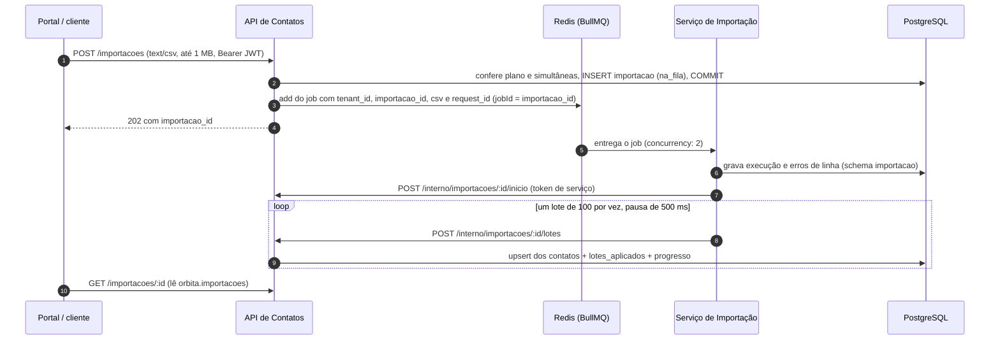

# ADR-004 — Comunicação entre a API e o Serviço de Importação

| Campo | Valor |
|---|---|
| **Status** | Aceito |
| **Data** | 2026-11-08 |
| **Decisores** | Andriel Schultz, Cristofer Mateus Rutzen |
| **Depende de** | [ADR-001 — Pool com RLS](adr-001-tenancy.md), [ADR-002 — Tenant no JWT](adr-002-identidade-tenant.md), [ADR-003 — Fila, lote e quota](adr-003-processamento-assincrono.md) |
| **Revisa** | ADR-003: o intervalo de 5 min entre jobs, o limite de 100 linhas para todos os planos, o CSV no S3 e o worker gravando direto no banco |

---

## Contexto

Na Etapa 2 o OrbitaTI virou dois serviços de verdade:

- **API de Contatos** (`services/api-contatos/`): porta de entrada. Autentica, resolve o tenant e grava no schema `orbita`.
- **Serviço de Importação** (`services/importacao/`): worker BullMQ que lê o CSV, valida as linhas e manda os contatos em lotes.

O ADR-003 decidiu **que** a importação vai para uma fila, em lotes de 100 com pausa de 500 ms. Ficaram em aberto
**como** os dois serviços conversam e o que acontece quando um deles cai. Na Etapa 1, o desenho
([`../02-arquitetura-c4.md`](../02-arquitetura-c4.md) e o registro do Encontro 11) supunha três coisas que o
código não fez:

1. o worker gravaria os contatos direto no banco, sob RLS;
2. o CSV ficaria num armazenamento S3, e o job levaria só um `arquivo_id`;
3. a API leria o progresso no schema `importacao`.

Este ADR registra o que foi construído no lugar, com a conta de cada número. Os números de referência estão no
`CLAUDE.md` ("Números do projeto") e em `services/api-contatos/src/planos.js`.

## Opções consideradas

### 1. Síncrono ou assíncrono entre a API e a Importação

| Opção | Como funciona | Problema |
|---|---|---|
| **A — HTTP síncrono** | A API chama o Serviço de Importação e espera o fim | Uma importação de 5.000 linhas leva pelo menos 24,5 s só de pausas (conta abaixo). A requisição do usuário ficaria presa esse tempo, e com a Importação fora o `POST /importacoes` falharia junto: falha em cascata |
| **B — Fila (Redis + BullMQ)** | A API grava a importação, enfileira o job e responde `202` na hora | Mais uma peça para operar (o Redis), e o resultado chega depois |

### 2. Como a Importação grava os contatos

| Opção | Como funciona | Problema |
|---|---|---|
| **A — INSERT direto em `orbita`** (desenho da Etapa 1) | O papel `importacao_svc` ganha GRANT em `orbita.contatos` | Dois serviços escrevendo na mesma tabela: as regras do contato (e-mail minúsculo, `COALESCE` na reimportação, deduplicação) teriam de existir duas vezes, e uma mudança de schema quebraria os dois serviços ao mesmo tempo |
| **B — Chamada à API** (`POST /interno/importacoes/:id/lotes`) | A Importação não tem nenhum GRANT em `orbita`; manda o lote para a API, que grava | Uma chamada HTTP por lote e um segredo a mais |

### 3. Onde fica o CSV enquanto espera o worker

| Opção | Como funciona | Problema |
|---|---|---|
| **A — Armazenamento S3** (desenho da Etapa 1) | A API grava o arquivo; o job leva `arquivo_id` | Mais um container (MinIO no compose e no kind), mais um segredo e mais uma política de acesso por prefixo, para arquivos de no máximo 1 MB que só vivem até o worker terminar |
| **B — CSV no payload do job** | O job leva o texto do CSV | O CSV ocupa memória do Redis enquanto o job existe (conta abaixo) |

## Decisão

**A API e a Importação conversam de forma assíncrona por uma fila BullMQ no Redis. O CSV de até 1 MB viaja
no payload do job. A Importação nunca toca o schema `orbita`: grava os contatos chamando rotas `/interno` da
API com um token de serviço próprio. O progresso fica em `orbita.importacoes`, atualizado pela API.**

Escolhemos 1B, 2B e 3B. O fluxo completo:

### Por que fila (1B)

- **A requisição responde na hora.** A API só confere os limites, grava a importação e enfileira. O trabalho de
  24,5 s ou mais acontece depois.
- **A Importação pode cair sem levar a API junto.** Com o worker fora, os jobs esperam no Redis e são
  processados quando ele volta (T-RES-01 e T-RES-02). Buscar, cadastrar e editar contatos continua funcionando.
- **O ritmo é de quem consome.** O worker decide a velocidade (lote, pausa e `concurrency: 2`), não o cliente
  que enviou o arquivo. É isso que protege o CQ-01.

### Por que a Importação grava pela API (2B)

- **Banco por serviço.** Cada serviço é dono do seu schema: a API de `orbita`, a Importação de `importacao`. O
  papel `importacao_svc` não tem **nenhum** GRANT em `orbita` (T-RLS-07). Se o worker for comprometido, ele não
  lê nem apaga contatos por SQL.
- **Uma regra de contato só, num lugar só.** E-mail em minúsculas, upsert `ON CONFLICT (tenant_id, email)`,
  `COALESCE` para não apagar com célula vazia (decisão I5) e limites de tamanho ficam na API. A importação e o
  cadastro manual passam pelo mesmo código.
- **O progresso não exige que a API leia `importacao`.** A rota `/lotes` atualiza `orbita.importacoes` na
  mesma transação do upsert. Com isso, o `GET /importacoes/:id` lê só o schema `orbita` (regra 10 do
  `CLAUDE.md`). Isso corrige a seta ⑨ do registro do Encontro 11, em que a API lia `importacao`.
- **Custo aceito:** uma chamada HTTP por lote. Com 5.000 linhas são 50 chamadas (5.000 ÷ 100), mais `inicio`:
  51 chamadas espalhadas em pelo menos 24,5 s. É pouco perto da pausa que o ADR-003 já impõe.

### Como o tenant atravessa os dois serviços

| Trecho | Onde o tenant está | Quem garante |
|---|---|---|
| Portal → API | Claim `tenant_id` do JWT de usuário (15 min) | Assinatura com `JWT_SEGREDO` (ADR-002) |
| API → fila | Campo `tenant_id` do payload do job, copiado de `request.user.tenant_id` | Só a API escreve na fila. O cliente nunca envia `tenant_id` (regra 1) |
| Worker → API | Claim `tenant_id` de um **token de serviço** novo a cada chamada | Assinatura com `JWT_SERVICO_SEGREDO`, `iss: importacao`, `aud: api-contatos`, vida máxima de 60 s |
| API → banco | `set_config('app.tenant_id', $1, true)` dentro de `withTenant` | RLS com `ENABLE` + `FORCE` (ADR-001) |

**Por que dois segredos, e não o `JWT_SEGREDO` para tudo:**

- **Com um segredo só, o worker forjaria qualquer usuário.** Quem tem o `JWT_SEGREDO` assina um token de
  usuário com qualquer `tenant_id` e qualquer `papel`. Um worker invadido viraria "admin" de qualquer tenant
  em todas as rotas da API.
- **Com dois segredos, cada token só abre a sua porta.** O token de serviço só abre `/interno/*`, e o de
  usuário recebe 401 lá (T-IMP-10). O caminho inverso também falha na assinatura: token de serviço em rota de
  usuário → 401 (T-ISO-12).
- **Menor privilégio também na configuração:** o worker não recebe o `JWT_SEGREDO` nem no compose nem no kind
  (decisão K5 do bloco 6). A API recusa subir se os dois segredos forem iguais.

**Por que 60 s de vida:** uma chamada de lote termina em menos de 1 s, e o worker assina um token novo a cada
chamada (custa um HMAC). Um token que vaze num log vale no máximo 60 s, e não 15 min como o de usuário. A
API recusa token de serviço com mais de 60 s de vida mesmo se a assinatura estiver certa (decisão I6, T-IMP-11).

### Idempotência: três camadas

Um job pode rodar mais de uma vez: há retry depois de erro e recuperação depois que o worker morre. Cada
camada cobre uma forma de repetição:

| Camada | O que impede | Teste |
|---|---|---|
| `jobId = importacao_id` no BullMQ | Enfileirar o mesmo job duas vezes | — (garantia do BullMQ) |
| PK `(importacao_id, numero)` em `orbita.lotes_aplicados` | Aplicar duas vezes o mesmo lote: o repetido responde `{aplicado: false}` e não grava | T-IMP-09 |
| Upsert `ON CONFLICT (tenant_id, email)` | Duplicar um contato, mesmo reimportando o arquivo inteiro | T-RLS-11, T-IMP-14 |

**Retry:** 3 tentativas, com espera de 2 s e depois 4 s (backoff exponencial que começa em 2 s:
2 + 4 = 6 s de espera no total). Um erro que tentar de novo não resolve (4xx da API, CSV ilegível) desiste na
hora, sem gastar as tentativas. Quando o job desiste, o worker chama `/interno/.../falha`.

**O worker morre no meio do job:** o BullMQ entrega o job de novo uma vez (`maxStalledCount` = 1). Os lotes
já aplicados respondem `{aplicado: false}` e o resto entra (T-IMP-14,
`scripts/ensaio-reprocessamento.ps1`). Se ele morrer **duas** vezes no mesmo job, a importação termina como
`falhou`. Ensaio de 08/11/2026: 14 de 50 lotes, 1.400 contatos, nenhum duplicado. Reimportar o mesmo arquivo
completa o resto.

### O CSV no payload, sem S3 (3B)

**De onde vem o limite de 5.000 linhas do plano Equipe:**

| Item | Conta |
|---|---|
| Tamanho máximo do CSV | 1 MB = 1.024 × 1.024 = 1.048.576 bytes (`bodyLimit` do `POST /importacoes`) |
| Linha típica (nome, e-mail, telefone, empresa, observação curta) | ~200 bytes |
| Linhas que cabem em 1 MB | 1.048.576 ÷ 200 ≈ 5.242 → arredondado para baixo: **5.000** |
| Plano Individual | **100** linhas. A DevSolo acumula ~150 contatos por ano e nunca importa em massa (ADR-003) |

Os dois limites valem **juntos**: 5.000 linhas **e** 1 MB. Linhas mais longas que 200 bytes batem no 1 MB
antes das 5.000 linhas.

**Quanto isso ocupa no Redis.** Um job vive no Redis da entrada na fila até terminar: `removeOnComplete`
apaga na hora o job concluído, e `removeOnFail` guarda o job que falhou por 24 h. O número de jobs ativos ao
mesmo tempo é limitado pelas importações simultâneas por tenant. Com os 45 tenants de referência
(36 Individual + 9 Equipe, [`../01-visao-produto.md`](../01-visao-produto.md)):

| Cenário | Conta | Total |
|---|---|---|
| **Pico realista** (todos importando ao mesmo tempo, linhas de ~200 bytes) | Equipe: 9 tenants × 5 importações × 1 MB = 45 MB. Individual: 36 × 2 × (100 linhas × 200 bytes = 20 KB) = 1,44 MB | **≈ 46 MB** |
| **Pior caso teórico** (todo job com 1 MB, inclusive os do Individual com 100 linhas longas ou inválidas) | (36 × 2 + 9 × 5) = 117 jobs × 1 MB | **≈ 117 MB** (≈ 112 MiB) |

Fora dessas contas ficam os jobs que falharam (guardados por 24 h), os contadores do rate limit e o espaço que
o próprio BullMQ usa. O CSV também cresce um pouco ao virar texto JSON no payload: cada quebra de linha vira
`\n`, ou seja, 5.000 bytes a mais em 5.000 linhas (0,5%).

**No kind, o limite estoura antes do gatilho.** O pod do Redis tem `limits.memory: 128Mi` (134 MB). O pior
caso teórico (117 MB) cabe nele, mas sem folga, e passar do limite faz o Kubernetes matar o pod (OOM),
levando a fila junto (próxima seção). O gatilho de 200 MB abaixo vale para **produção**, com o Redis
dimensionado para isso. No kind, a proteção é a pendência de código P-1 (seção "Pendências de código").

**Por que não S3 agora:** o arquivo tem no máximo 1 MB e só existe até o worker terminar. Guardar em S3
exigiria mais um container, mais um segredo, a política de acesso por prefixo e a limpeza dos arquivos, tudo
para um dado que o Redis já guarda durante o mesmo tempo. O S3 continua no desenho para os PDFs e anexos da
Etapa 1, que hoje estão fora do escopo do semestre.

### Tempo de uma importação, sem o intervalo de 5 min

O ADR-003 previa 5 min entre jobs de 100 contatos. Esse intervalo foi retirado (nota de revisão do ADR-003). O
worker pausa 500 ms **entre** lotes: não há pausa depois do último lote, nem depois de um lote repetido que não
gravou nada.

| Importação | Lotes (÷ 100) | Pausas (lotes − 1) × 500 ms | Com o intervalo de 5 min do ADR-003 |
|---|---|---|---|
| Planilha da TechConsult, 640 linhas | 7 | 6 × 0,5 = **3 s** | 7 jobs → 6 × 5 min = 30 min |
| 1.200 contatos (TechConsult em 12 meses) | 12 | 11 × 0,5 = **5,5 s** | 12 jobs → 55 min ("cerca de uma hora") |
| 3.000 contatos | 30 | 29 × 0,5 = **14,5 s** | 30 jobs → 145 min ("várias horas") |
| 5.000 linhas (máximo do Equipe) | 50 | 49 × 0,5 = **24,5 s** | 50 jobs → 245 min ≈ 4 h |

A esses tempos soma-se o tempo de gravação de cada lote, que o bloco 9 mede junto com o CQ-01. O T-IMP-13
(`TESTES_LENTOS=1`) prova que a pausa existe.

**O que protege os outros tenants agora** não é um intervalo entre jobs, mas três limites que valem juntos:

1. **Lote de 100 + pausa de 500 ms:** cada importação grava no máximo 100 linhas por vez e devolve o banco
   entre um lote e outro.
2. **`concurrency: 2` no worker:** no máximo 2 importações tocam o banco ao mesmo tempo, somando todos os
   tenants. Dá no máximo 2 × 100 = 200 linhas em gravação simultânea vindas de importação. A terceira espera na
   fila.
3. **Importações simultâneas por tenant** (Individual 2, Equipe 5), contadas no banco no `POST /importacoes`.
   Acima disso, a resposta é 429 `IMPORTACOES_SIMULTANEAS` (T-IMP-08). A contagem é no banco porque limite por
   grupo no BullMQ é recurso do BullMQ Pro, que é pago.

### Quando a Importação ou o Redis caem

| O que caiu | O que o usuário vê | Por quê | Prova |
|---|---|---|---|
| **Serviço de Importação** | Tudo funciona. Importações novas são aceitas (`202`) e ficam `na_fila` até o worker voltar | A fila guarda o job; a API não depende do worker | T-RES-01, T-RES-02 |
| **Redis** | Tudo funciona, menos `POST /importacoes`, que responde 503 `FILA_INDISPONIVEL` rápido. O rate limit fica desligado enquanto isso | Conexão BullMQ com `enableOfflineQueue: false`: falha na hora em vez de esperar. O rate limit usa `skipOnError: true` (ADR-003) | T-RES-03, T-RES-04 |
| **Redis volta** | `POST /importacoes` volta a responder `202` sozinho, sem reiniciar a API | A `Queue` é recriada quando a conexão fica pronta (achado I8, abaixo) | T-RES-05 |
| **`/saude` com o Redis fora** | `200 {"db": "ok", "fila": "fora"}`. Só o banco fora dá 503 | A readiness do kind não pode tirar a API do ar por causa da fila (decisão P2) | T-OBS-03 |

**O Redis roda sem persistência.** No compose não há AOF nem volume declarado para ele; no kind, o `/data` é
um `emptyDir`, que some quando o pod é recriado. Se o Redis reiniciar, os jobs que estavam nele podem sumir, e
as importações correspondentes ficam `na_fila` (ou `processando`) para sempre em `orbita.importacoes`:

- o Portal mostra "na fila" sem fim;
- cada uma **ocupa uma vaga de importação simultânea**. No Individual são 2: duas importações presas e o
  tenant não importa mais nada.

É o mesmo efeito do risco I1, a seguir, e a mesma mitigação resolve os dois.

### Fila de e-mails: API → Notificações (bloco 10, 08/11/2026)

O mesmo padrão da importação, aplicado ao e-mail de confirmação de cadastro. **Não muda nenhuma decisão
deste ADR**: é a opção 1B (fila) para um segundo consumidor.

| Ponto | Como ficou | Por quê |
|---|---|---|
| Fila | `emails`, na mesma conexão Redis da API (`fila.js`) | Um Redis, duas filas: nada novo para operar |
| Quando enfileira | **Depois do COMMIT** do cadastro | Antes, um ROLLBACK deixaria no ar um e-mail para um usuário que não existe |
| Fila fora | O cadastro responde 201 e registra `warn` (`email_nao_enfileirado`) | O e-mail não pode impedir o onboarding; o login não exige confirmação (T-RES-06) |
| O que vai no job | `{tipo, para, nome, link, request_id, tenant_id}` | O Serviço de Notificações **não tem banco**, nem papel no Postgres: tudo o que o e-mail precisa vem no job |
| Idempotência | `jobId = confirmar-cadastro-<usuario_id>` | O BullMQ ignora um segundo `add` com o mesmo id. **Sem `:`**: o BullMQ 6 recusa `:` em id próprio (achado N6) |
| Tentativas | 5, backoff exponencial de 2 s; `removeOnComplete`; `removeOnFail` de 24 h | O job tem e-mail e um link que vale 24 h como credencial: não fica no Redis depois de usado |
| Worker | `concurrency: 5`, nodemailer, SMTP do Mailpit (local e kind) | O trabalho é esperar a rede, não CPU nem banco. Dado inválido é `UnrecoverableError`: não tenta de novo |
| Token do link | JWT com `JWT_SEGREDO`, 24 h, `finalidade: "confirmar-email"` | Recusa explícita nos dois lados: o link não abre sessão (T-AUTH-11) e a sessão não confirma e-mail (T-AUTH-12). Decisão N3 em `pendencias-bloco-7.md` |

**O que falta para a VM:** SMTP do provedor real com autenticação e TLS, e remetente com SPF/DKIM (N4).

### Riscos aceitos

**I1 — A API morre entre o COMMIT e o enfileiramento.** O `POST /importacoes` grava a importação (`na_fila`),
faz COMMIT e **só depois** enfileira o job.

- **Se enfileirar falhar,** uma transação de compensação apaga o registro e a resposta é 503 (T-IMP-22).
- **A ordem é proposital.** Enfileirar antes do COMMIT abriria uma corrida: o worker poderia chamar `/inicio`
  antes de a linha existir e receber 404.
- **O que sobra:** se o processo **morrer** exatamente entre o COMMIT e o `add` (OOM, `kill`, o kind
  reiniciando o pod), a compensação nunca roda. A importação fica `na_fila` para sempre, e o CSV, que só
  existia na memória da API, se perde.
- **Por que aceitamos:** a janela é de milissegundos (um `add` no Redis) e exige o processo morrer exatamente
  nela.

**Mitigação proposta para I1 e para o Redis que reinicia: o "faxineiro"** (pendência de código P-2). Ele roda
no próprio `POST /importacoes`, só para o tenant que está importando e antes de contar as simultâneas:

1. para cada importação `na_fila` do tenant com mais de 2 minutos, ou `processando` sem lote novo há mais de
   5 minutos, pergunta ao BullMQ se o job existe (`queue.getJob(importacao_id)`, possível porque
   `jobId = importacao_id`);
2. se o job não existir, ou estiver `failed`, marca a importação como `falhou`.

Por que esse desenho:

- **Custo:** uma consulta ao Redis por importação velha, só quando o tenant tenta importar de novo. Não precisa
  de processo novo nem de cron.
- **Resultado:** o Portal passa a mostrar "falhou" e a vaga é liberada.
- **Por que 2 minutos:** é folga para um job que está de fato esperando o worker, porque a `concurrency: 2` pode
  segurar a fila por algumas dezenas de segundos em pico (uma importação de 5.000 linhas leva 24,5 s só de
  pausa).
- **Alternativa mais robusta, se o problema aparecer de verdade:** um *outbox*. O CSV seria gravado no banco
  junto com a importação, e um processo separado enfileiraria e apagaria. Isso tira o CSV do payload e
  contraria a decisão 3B, por isso fica só registrado.

**O que ainda pode deixar uma importação presa em `processando`,** e o faxineiro também cobre:

- nenhum worker volta a subir;
- o `POST /interno/.../falha` falha no instante do aviso (API fora). O worker só registra no log, e o BullMQ
  não tenta de novo.

**J8 — Quem já está na rede interna pode forjar o `X-Forwarded-For`.** Ver "Borda: Nginx → API".

### Borda: Nginx → API (IP real para o rate limit)

O rate limit de login (10/min por IP + e-mail) e o de cadastro (60/min por IP) precisam do IP de quem está do
lado de fora. Atrás do Nginx do Portal, a API só vê o IP do Nginx.

- **`trustProxy` por número de saltos não funciona mais (J4).** Desde o Fastify 5.12.1 (advisory
  GHSA-3m5p-2c4r-xxw2), `trustProxy: <número>` não confia em ninguém, porque contar saltos não confere **quem**
  conectou. Implementado no lugar:
  - `TRUST_PROXY_SALTOS` (padrão 1);
  - e a conexão precisa vir de **rede interna** (loopback, 10/8, 172.16/12, 192.168/16, link-local).

  Se a API for exposta por engano na internet, o header de quem vem de fora é ignorado (T-RL-06).
- **Por que não fixar uma sub-rede confiável (J5):** o compose escolhe a sub-rede sozinho. Fixar uma arrisca
  colidir com a rede da VM do LARCC, e no kind a rede de pods é outra. "Rede interna" cobre os três ambientes
  sem configuração.
- **No kind, `TRUST_PROXY_SALTOS=0` (J6).** A API está exposta direto pelo NodePort 30080, e o NAT do
  kube-proxy faz o tráfego chegar com IP interno. Com 1, qualquer um forjaria o header. Passa para 1 quando o
  Nginx do Portal entrar na frente (Fase 6 do bloco 13).
- **Risco aceito K2 do bloco 6** (não confundir com a decisão K2 do contrato): com 0, todos os clientes de `localhost:30080` chegam com o mesmo IP, e o limite de
  cadastro vira global (60/min para todos juntos). O de confirmação de e-mail (10/min por IP, bloco 10) também.
  Aceitável no laboratório, com um usuário só. Num cluster real: `externalTrafficPolicy: Local` ou o Nginx na frente.
- **Risco aceito J8:** com `TRUST_PROXY_SALTOS=1`, quem já está na rede interna (outro contêiner do compose,
  alguém no host chamando `127.0.0.1:3000`) pode mandar um IP diferente a cada tentativa e ganhar um contador
  de login novo. Quem está de fora não consegue:
  - a porta 3000 só escuta em `127.0.0.1`;
  - o Nginx acrescenta o IP real no **fim** do header (`$proxy_add_x_forwarded_for`);
  - com 1 salto, a API só usa esse último endereço.

  Para forjar, é preciso já ter acesso ao host ou à rede dos contêineres. Aí o atacante tem caminhos melhores
  do que adivinhar senha.

### Decisões do contrato HTTP

O contrato entre Portal e API ([`../contrato-api.md`](../contrato-api.md)) foi escrito antes do código e
trouxe decisões que este ADR registra. O porquê de cada uma está na seção 11 do contrato. Em resumo:

Os números K1 a K6 são os da seção 4 de `pendencias-bloco-7.md` (decisões do contrato), e I2 a I7 os da
seção 7.2.

| # | Decisão |
|---|---|
| K1 | Formato único de erro `{erro, codigo}`; o Portal e os testes decidem pelo `codigo`, nunca pelo texto |
| K2 | Campos e tamanhos do contato; busca `ILIKE` com até 100 resultados |
| K3 | CSV com cabeçalho obrigatório, separador `,` ou `;` decidido pelo cabeçalho (I4), BOM aceito; 422 para CSV vazio ou sem colunas |
| K4 | Rotas `/interno/.../inicio` e `/falha`; `total_lotes` informado pelo worker. Sem elas a importação podia nunca concluir |
| K5 | "Esfriando" usa `COALESCE(ultima_interacao_em, criado_em)`; interação usa `GREATEST` |
| K6 | `GET /planos` pública e sem rate limit; `PORTAL_URL` nos links de e-mail; porta 3000 só em `127.0.0.1` |
| I2 | `inicio` repetido mantém os primeiros números; lote depois de `falhou` não é aplicado; `numero` além de `total_lotes` → 400 |
| I3 | E-mail repetido no mesmo arquivo vira erro de linha (o upsert daria 500 no PostgreSQL) |
| I5 | Reimportação com `COALESCE`: célula vazia não apaga dado que já existia |
| I7 | Limitação declarada: a API conta linhas físicas, o worker conta registros do CSV. Célula com quebra de linha dentro de aspas conta 2 na API e 1 no worker |

### Achado I8: por que o teste de integração existe

Com `skipWaitingForReady` e `enableOfflineQueue: false`, a `Queue` do BullMQ manda um `INFO` ao Redis assim que
é criada. A API subia antes de a conexão ficar pronta, o `INFO` falhava, e a `Queue` guardava essa falha para
sempre. A partir daí, todo `add()` recebia "Stream isn't writeable", **com o Redis no ar**.

Os testes unitários, que usam fila simulada, não pegavam o problema. O teste de integração contra a stack real
pegou. Correção: a `Queue` só é criada quando a conexão está `ready`, e é recriada se a inicialização falhar.

### Decisão J10: histórico de execução de um job travado

`importacao.execucoes` perde a história quando o worker morre no meio de um job:

- **(a) A linha da execução é sobrescrita.** A reexecução depois do travamento usa a mesma `tentativa`
  (`job.attemptsMade + 1`), porque o BullMQ não incrementa `attemptsMade` em job travado.
- **(b) A linha fica `processando` para sempre.** Na falha adiada (2ª queda), o BullMQ falha o job sem chamar o
  processador.

O que o usuário vê (`orbita.importacoes`) fica certo; só o histórico interno fica errado.

**Decisão:** usar `job.attemptsStarted` como número da execução e, no `worker.on('failed')`, marcar a execução
como `erro`. **Implementação pendente** (pendência de código P-3): o Bloco 7 não altera código.

## Consequências

### Positivas

- **A Importação pode cair sem derrubar o CRM.** Com o Redis fora, só `POST /importacoes` para (503), e o
  resto segue. Provado pela `scripts/demo-degradacao.ps1` (T-RES-01 a 05 e 07).
- **O worker não tem acesso ao dado de contato por SQL.** O isolamento entre serviços vale também no banco
  (T-RLS-07), não só no código.
- **Repetir é seguro em qualquer ponto.** Retry, worker que morre e reimportação não duplicam contatos
  (T-IMP-09, T-IMP-14).
- **Nenhum container a mais para o CSV.** A stack da Etapa 2 é Postgres, Redis, API, worker e migração.
- **A TechConsult migra a planilha de 640 linhas em segundos,** não em 30 minutos, e o CQ-01 continua protegido
  pelo lote, pela pausa e pela `concurrency: 2`.

### Negativas

- **O CSV ocupa memória do Redis enquanto o job existe.** Até ≈ 117 MB no pior caso teórico, contra 128 MiB
  do pod no kind. *Mitigação:* pendência P-1 (`maxmemory` + `noeviction`).
- **Redis sem persistência.** Um restart pode perder jobs e prender importações em `na_fila`, ocupando vagas.
  *Mitigação:* o faxineiro (P-2).
- **Uma chamada HTTP por lote.** São 51 chamadas numa importação de 5.000 linhas. É desprezível perto das
  pausas, mas a importação passa a depender da API estar no ar. API fora durante a importação → retry do
  BullMQ (2 s e 4 s); depois disso, `falhou`.
- **Dois segredos para gerenciar** (`JWT_SEGREDO` e `JWT_SERVICO_SEGREDO`), em vez de um.
- **`concurrency: 2` é global, por processo do worker.** Com 2 réplicas do worker seriam 4 importações tocando
  o banco ao mesmo tempo. Escalar o worker exige refazer a conta do CQ-01.
- **Uma importação que espera pode atrasar.** Com as 2 vagas do worker ocupadas por importações de 5.000
  linhas, a próxima espera pelo menos 24,5 s para começar.

## Pendências de código abertas por este ADR

| # | O quê | Por quê | Onde |
|---|---|---|---|
| P-1 | No kind, configurar o Redis com `maxmemory` abaixo do `limits.memory` do pod (128 MiB) e `maxmemory-policy noeviction` | Com `noeviction`, o Redis cheio **recusa escritas**: o `add()` falha e o `POST /importacoes` responde 503 `FILA_INDISPONIVEL`, como já acontece com o Redis fora. Sem isso, o pod passa do limite, o Kubernetes o mata (OOM) e a fila inteira se perde. Na implementação, conferir também o que o worker e o rate limit fazem com o Redis cheio (o rate limit tem `skipOnError` e é ignorado) | `deploy/k8s/20-redis.yaml` (e o mesmo no compose) |
| P-2 | O "faxineiro" no `POST /importacoes` | Libera as vagas presas por I1, por um restart do Redis e por um `/falha` que não chegou | `services/api-contatos/src/rotas/importacoes.js` |
| P-3 | J10: `job.attemptsStarted` como número da execução e `erro` no `worker.on('failed')` | Histórico correto em `importacao.execucoes` | `services/importacao/src/` |

## Gatilhos de revisão

| Gatilho | Por quê |
|---|---|
| O limite do CSV passar de 5 MB | Com 5 MB por job, o pico realista vira 9 × 5 × 5 MB = 225 MB, acima do gatilho de 200 MB. Nesse tamanho, o S3 (ou outro armazenamento de objetos) passa a valer o container a mais |
| A memória usada pela fila no Redis passar de 200 MB | O CSV no payload deixou de ser barato. Reavaliar S3 ou *outbox* |
| Mais de uma réplica do worker | A `concurrency: 2` deixa de ser o teto global, e a conta de proteção do CQ-01 muda |
| Importações presas em `na_fila` aparecerem fora de ensaio | O risco I1 deixou de ser raro. Implementar o faxineiro (P-2) ou o *outbox* |
| A Importação precisar ler dado de contato (ex.: validar contra contatos existentes) | Criar uma rota `/interno` de leitura, nunca um GRANT em `orbita` |

## Referências

- [ADR-001 — Pool com RLS](adr-001-tenancy.md), [ADR-002 — Tenant no JWT](adr-002-identidade-tenant.md),
  [ADR-003 — Fila, lote e quota](adr-003-processamento-assincrono.md)
- Contrato HTTP, seções 7, 8 e 11: [`../contrato-api.md`](../contrato-api.md)
- Plano de testes (T-IMP, T-RES, T-RL, T-ISO): [`../plano-de-testes.md`](../plano-de-testes.md)
- Origem de cada decisão (D, C, I, J, K): [`../pendencias-bloco-7.md`](../pendencias-bloco-7.md)
- Diagrama de containers da Etapa 2: [`../02-arquitetura-c4.md`](../02-arquitetura-c4.md#estado-na-etapa-2)
- BullMQ. *Retrying failing jobs* e *Stalled jobs*. Documentação oficial.
