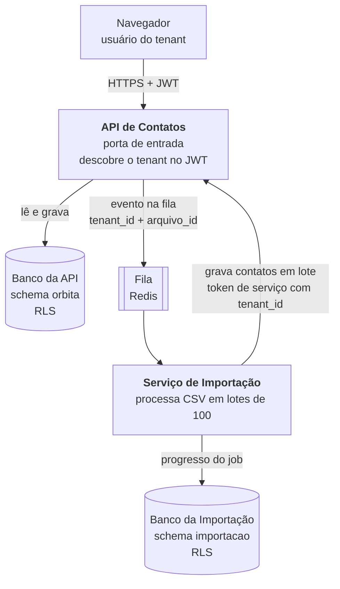

# Rascunho de serviços — OrbitaTI

**Unidade:** Andriel Schultz
**Origem:** verso da folha de registro do Encontro de 15/10 — rascunho do ADR de comunicação da Etapa 2 (29/10)

---

## 1. As caixas

**Foto do desenho:** `docs/desenho-servicos.jpg`

Cada serviço é dono do próprio schema. A Importação não escreve direto na tabela de contatos: ela pede para a API.

---

## 2. Quatro respostas

**a) Qual é o segundo serviço, e o que ele recebe do primeiro?**
O Serviço de Importação; recebe da API de Contatos, pela fila, um evento com `tenant_id`, `arquivo_id` e `usuario_id`.

**b) Onde o tenant é descoberto, e como chega ao segundo serviço?**
Na API de Contatos, a partir do claim do JWT assinado; chega à Importação dentro da mensagem na fila, nunca por parâmetro vindo do cliente.

**c) Se alguém esquecer o filtro no código, o que segura o vazamento?**
O Row-Level Security do PostgreSQL com `FORCE`: sem o `WHERE`, o banco devolve só as linhas do tenant da sessão.

**d) Se o segundo serviço cair, o que o usuário ainda consegue fazer?**
Tudo menos importar em massa: login, busca, cadastro manual e oportunidades seguem; os jobs ficam na fila e são processados quando ele voltar.

---

## Pendências até 29/10

- [ ] Subir a foto do desenho como `docs/desenho-servicos.jpg`
- [ ] Transformar este rascunho no ADR-004 — comunicação entre serviços
- [ ] Implementar os dois serviços com isolamento demonstrável ao vivo

