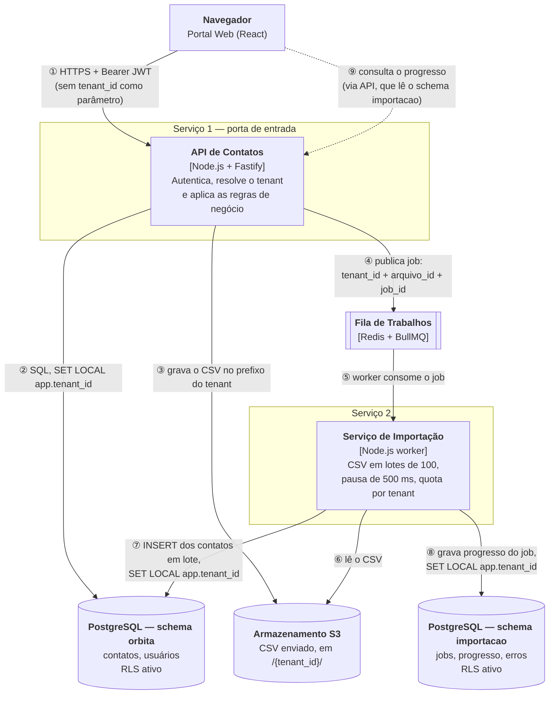

# Folha de Registro — Encontro de 15/10
**Arquitetura de Software SAAS · o CampoConta rodando**

- **Nome:** _Cristofer Mateus Rutzen_  
- **Unidade de PI:** **OrbitaTI**

---

## Frente da Folha

### Abertura (2 min, sem consulta)

* **O que é um microsserviço?**  
  É um componente autônomo, desacoplado e focado em um único domínio de negócio (*Bounded Context*), com ciclo de deploy independente e banco de dados próprio.

* **E o que muda nele quando o produto é multi-tenant?**  
  Todo o ciclo de vida da requisição e a persistência precisam de isolamento por cliente (*tenant*). As requisições exigem contexto de identificação (ex.: `tenant_id` via token/header) e o banco precisa garantir segregação lógica ou física para impedir vazamento de dados entre empresas.

---

### Os Seis Experimentos

| Experimento | Minha previsão (antes) | O que saiu (depois) | O nome disso |
| :--- | :--- | :--- | :--- |
| **1 — Seguir uma requisição** | A requisição recebe um ID único na entrada que é repassado a todos os serviços para podermos rastreá-la nos logs. | Logs correlacionados em diferentes serviços com o mesmo identificador de ponta a ponta. | **Rastreamento Distribuído (*Correlation ID* / Tracing)** |
| **2 — A Buricá tenta ver o dado da Alvorada** | A tentativa é bloqueada com erro 403 Forbidden ou lista vazia, impedindo acesso a dados alheios. | A consulta retornou lista vazia (`[]`) ou acesso não autorizado, isolando os dados de cada tenant. | **Isolamento de Tenant / Segregação de Dados (*Data Isolation* / RLS)** |
| **3 — O relatório da diretoria** | A consulta analítica pesada vai consumir recursos da base de dados e degradar as operações diárias dos usuários. | Queda de desempenho nas operações transacionais devido ao consumo excessivo de CPU/memória no banco compartilhado. | **Separação OLTP vs. OLAP (Réplica de Leitura / CQRS)** |
| **4 — A cobrança sai do ar** | O serviço que gera a venda/pedido falha ou fica travado aguardando resposta da cobrança. | Falha em cascata (se chamada síncrona direta) ou enfileiramento assíncrono mantendo o fluxo estável. | **Falha em Cascata (*Cascading Failure*) / Resiliência (*Circuit Breaker*)** |
| **5 — O mesmo evento chega duas vezes** | O sistema pode cobrar ou duplicar registros se não conferir se a mensagem já foi processada. | O segundo evento foi reconhecido como duplicado e descartado com segurança, sem duplicar o registro. | **Idempotência (*Idempotent Consumer*)** |
| **6 — O vizinho barulhento** | Uma empresa consumindo requisições em massa vai esgotar o pool de conexões e deixar o sistema lento para as demais. | A carga alta do tenant agressivo aumentou a latência e afetou os tempos de resposta dos outros clientes. | **Efeito do Vizinho Barulhento (*Noisy Neighbor*) / Rate Limiting** |

---

### No fim do encontro (2 min)

* **Releia a sua resposta de abertura e reescreva:**  
  Microsserviço é uma unidade independente de negócio e infraestrutura. No modelo multi-tenant, ele não opera de forma agnóstica: todo fluxo exige a identidade do inquilino (`tenant_id`), com isolamento rigoroso de dados (RLS, schema ou base dedicada), observabilidade contextualizada e proteção de recursos (rate limit por tenant) para evitar contaminação de segurança ou lentidão mútua entre clientes.

---

## Verso — O Seu Produto (OrbitaTI)

> **Foto do desenho:** `docs/desenho-servicos.jpg`
> Versão digitada e completa, com as pendências até 29/10: [`servicos-rascunho.md`](servicos-rascunho.md)

### 1. As caixas

**Uma seta por conversa:**

| # | De → Para | Tipo | O que trafega |
|---|---|---|---|
| ① | Navegador → API de Contatos | Síncrona, HTTPS | Requisição com JWT; o cliente nunca envia `tenant_id` |
| ② | API → schema `orbita` | SQL | Leitura e escrita de contatos e usuários, sob RLS |
| ③ | API → Armazenamento S3 | API de objetos | CSV recebido, gravado em `/{tenant_id}/...` |
| ④ | API → Fila | **Assíncrona** | Job com `tenant_id`, `arquivo_id` e `job_id` |
| ⑤ | Fila → Serviço de Importação | Assíncrona | Entrega do job ao worker |
| ⑥ | Importação → Armazenamento S3 | API de objetos | Leitura do CSV pelo `arquivo_id` |
| ⑦ | Importação → schema `orbita` | SQL em lote | Contatos inseridos em lotes de 100 |
| ⑧ | Importação → schema `importacao` | SQL | Estado e progresso do job |
| ⑨ | Navegador → API (→ schema `importacao`) | Síncrona | Consulta de progresso da importação |

**Onde cada serviço guarda dado**

- **API de Contatos:** schema `orbita` (contatos, usuários) e o prefixo `/{tenant_id}/` do armazenamento.
- **Serviço de Importação:** schema `importacao` (jobs, progresso, erros por linha).

---

### 2. Quatro respostas

**a) Qual é o segundo serviço, e o que ele recebe do primeiro?**
O Serviço de Importação; recebe da API de Contatos, pela fila, um job com `tenant_id`, `arquivo_id` e `job_id` (o CSV em si fica no armazenamento, não na mensagem).

**b) Onde o tenant é descoberto, e como chega ao segundo serviço?**
Na API de Contatos, no middleware que lê o claim `tenant_id` do JWT assinado (ADR-002); chega ao segundo serviço no payload do job e o worker o reaplica com `SET LOCAL app.tenant_id` antes de qualquer query.

**c) Se alguém esquecer o filtro no código, o que segura o vazamento?**
O Row-Level Security do PostgreSQL (ADR-001): a política `tenant_id = current_setting('app.tenant_id')` vale em toda tabela, então um `SELECT` sem `WHERE` só enxerga o tenant da sessão, e sem tenant definido não devolve linha nenhuma.

**d) Se o segundo serviço cair, o que o usuário ainda consegue fazer?**
Tudo, menos importar contatos em massa: buscar, cadastrar e editar contatos continua na API; os jobs de importação ficam na fila e são processados quando o serviço voltar.
