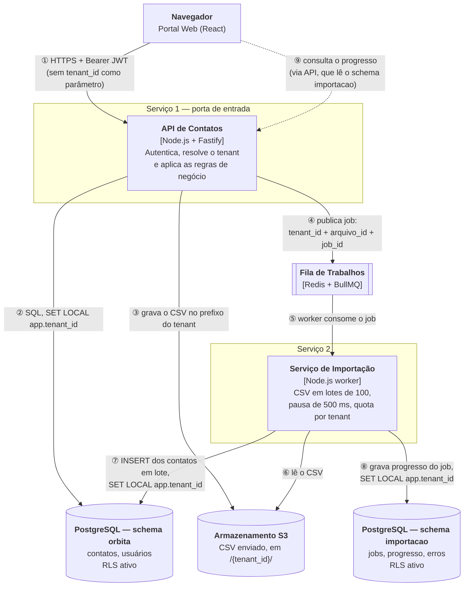

# Rascunho dos serviços — OrbitaTI

**Unidade:** Andriel Schultz e Cristofer
**Origem:** verso da folha de registro do Encontro de 15/10 (Arquitetura de Software SaaS)
**Status:** rascunho do ADR de comunicação da Etapa 2 (defesa em 29/10)

> **Foto do desenho:** [`desenho-servicos.jpg`](desenho-servicos.jpg) — foto do verso da folha, salva nesta pasta (`docs/`).
> O diagrama abaixo é a versão digitada do mesmo desenho.

---

## 1. As caixas

**Uma seta por conversa:**

| # | De → Para | Tipo | O que trafega |
|---|---|---|---|
| ① | Navegador → API de Contatos | Síncrona, HTTPS | Requisição com JWT; o cliente nunca envia `tenant_id` |
| ② | API → schema `orbita` | SQL | Leitura e escrita de contatos e usuários, sob RLS |
| ③ | API → Armazenamento S3 | API de objetos | CSV recebido, gravado em `/{tenant_id}/...` |
| ④ | API → Fila | **Assíncrona** | Job com `tenant_id`, `arquivo_id` e `job_id` |
| ⑤ | Fila → Serviço de Importação | Assíncrona | Entrega do job ao worker |
| ⑥ | Importação → Armazenamento S3 | API de objetos | Leitura do CSV pelo `arquivo_id` |
| ⑦ | Importação → schema `orbita` | SQL em lote | Contatos inseridos em lotes de 100 |
| ⑧ | Importação → schema `importacao` | SQL | Estado e progresso do job |
| ⑨ | Navegador → API (→ schema `importacao`) | Síncrona | Consulta de progresso da importação |

**Onde cada serviço guarda dado**

- **API de Contatos:** schema `orbita` (contatos, usuários) e o prefixo `/{tenant_id}/` do armazenamento.
- **Serviço de Importação:** schema `importacao` (jobs, progresso, erros por linha).

---

## 2. Quatro respostas

**a) Qual é o segundo serviço, e o que ele recebe do primeiro?**
O Serviço de Importação; recebe da API de Contatos, pela fila, um job com `tenant_id`, `arquivo_id` e `job_id` (o CSV em si fica no armazenamento, não na mensagem).

**b) Onde o tenant é descoberto, e como chega ao segundo serviço?**
Na API de Contatos, no middleware que lê o claim `tenant_id` do JWT assinado (ADR-002); chega ao segundo serviço no payload do job e o worker o reaplica com `SET LOCAL app.tenant_id` antes de qualquer query.

**c) Se alguém esquecer o filtro no código, o que segura o vazamento?**
O Row-Level Security do PostgreSQL (ADR-001): a política `tenant_id = current_setting('app.tenant_id')` vale em toda tabela, então um `SELECT` sem `WHERE` só enxerga o tenant da sessão, e sem tenant definido não devolve linha nenhuma.

**d) Se o segundo serviço cair, o que o usuário ainda consegue fazer?**
Tudo, menos importar contatos em massa: buscar, cadastrar e editar contatos continua na API; os jobs de importação ficam na fila e são processados quando o serviço voltar.

---

## 3. Pendências até 29/10

Pontos que o desenho ainda não fecha; entram como primeiras pendências, como a folha permite.

1. **Quem escreve em `orbita.contatos`?** No rascunho, o Serviço de Importação insere direto no schema da API (seta ⑦), o que acopla os dois serviços pelo banco. Alternativa: a importação chama um endpoint interno da API. Ainda não decidimos; precisa virar ADR.
2. **RLS no schema `importacao`.** A tabela de jobs também carrega `tenant_id` e precisa da mesma política; falta escrever a migração e o teste que prova o isolamento.
3. **Consulta de progresso (seta ⑨).** Ainda não sabemos se a API lê o schema `importacao` diretamente ou se o Serviço de Importação expõe um endpoint próprio.
4. **Reentrega de job.** Se a fila entregar o mesmo job duas vezes, a importação precisa ser idempotente (por `job_id` + linha do CSV). Ainda não projetado.
5. **Token congelado.** O claim `tenant_id` vale pela vida do token (consequência assumida no ADR-002); falta definir a validade do token e o que o worker faz com um job de um usuário já desvinculado.

---

*Referências: [`adr/adr-001-tenancy.md`](adr/adr-001-tenancy.md) · [`adr/adr-002-identidade-tenant.md`](adr/adr-002-identidade-tenant.md) · [`adr/adr-003-processamento-assincrono.md`](adr/adr-003-processamento-assincrono.md) · [`02-arquitetura-c4.md`](02-arquitetura-c4.md)*
